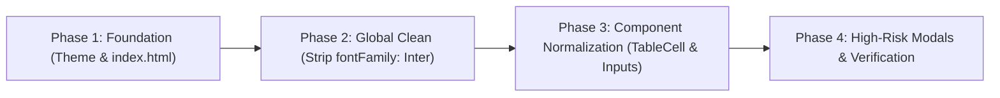

# ADMIN Font Audit Report

> **Target Scope:** `src/apps/admin/**` (React 19 + Vite 8 + Material UI v9)
> **Audit Date:** November 5, 2026
> **Mode:** READ-ONLY Static AST & Regex Analysis (Zero source files modified)

## Executive Summary

1. **Admin Files Analyzed:** 163 JavaScript/JSX files audited under `src/apps/admin/**`.
2. **Font Family Instances:** 792 total occurrences (583 hardcoded string `"Inter, sans-serif"`, 186 via local `const FONT`, 9 `"monospace"`, 9 `!important`, 2 missing font `DM Sans`, 2 `inherit`, 1 full monospace font stack).
3. **Font Size Chaos:** 2,187 total hardcoded font-size declarations across 70 distinct values ranging from 10px to 36px.
4. **Near-Duplicate Micro-Scales:** 141 occurrences of 13.5px, 68 of 12.5px, 23 of 11.5px, 21 of 14.5px, and 13 of 10.5px.
5. **Extreme Theme Bypass:** 95.3% (1,107 of 1,161) of `<Typography>` components override `fontSize` in `sx`, while only 2.2% (26) use explicit MUI variants.
6. **Font Weight Distribution:** 1,326 total instances dominated by 600 (634, 47.8%), 700 (296, 22.3%), and 500 (266, 20.1%).
7. **Theme Isolation:** 1 isolated nested `<ThemeProvider>` in `UploadLeadsDialog.jsx` that replaces rather than extends the root theme.
8. **Missing Web Font:** `DM Sans` is referenced in 2 admin user modals but is never loaded in `index.html`.
9. **Root Cause Identified:** `src/main.jsx` lacks fallback fonts and omits `fontFamily: "inherit"` on native input/button elements.
10. **Scale Consolidation:** All 70 existing sizes can be mapped cleanly into a 7-step scale (`10, 12, 13, 14, 16, 18, 22px`).

---

## 1. Environment Baseline

### Commands Executed
```bash
npm ci
npm run lint
npm run build
```

### 1.1 `npm ci` Results
- **Status:** Passed (Exit code 0)
- **Output Summary:** `added 313 packages in 49s`
- **Packages:** 313 installed packages audited (0 vulnerabilities reported)

### 1.2 `npm run lint` Results
- **Status:** Failed with lint warnings/errors (Exit code 1)
- **Total Problems:** 350 problems (281 errors, 69 warnings)

#### Top 10 Linter Rules by Violation Count
| Rank | ESLint Rule | Count | Severity | Category |
|---|---|---|---|---|
| 1 | `no-unused-vars` | 119 | Error | Code Quality |
| 2 | `react-hooks/set-state-in-effect` (renders) | 106 | Error | React Lifecycle |
| 3 | `react-hooks/exhaustive-deps` | 69 | Warning | React Hooks |
| 4 | `react-hooks/immutability` (declared TDZ) | 32 | Error | React State |
| 5 | `react-refresh/only-export-components` | 16 | Warning | HMR Build |
| 6 | `preserved` (react-hooks) | 3 | Error | React Compiler |
| 7 | `no-useless-assignment` | 3 | Error | Code Quality |
| 8 | `render` (react-hooks) | 1 | Error | React Lifecycle |
| 9 | `no-empty` | 1 | Error | Code Quality |
| 10 | *(All other lint rules clean)* | 0 | - | - |

### 1.3 `npm run build` Results
- **Status:** Passed (Exit code 0)
- **Duration:** 4.45 seconds
- **Warnings:** 1 Vite bundle size warning (`(!) Some chunks are larger than 500 kB after minification`)

#### Production Bundle Size Summary
| Chunk Asset | Minified Size | Gzip Size |
|---|---|---|
| `dist/assets/xlsx.min-BxIC-lth.js` | 863.21 kB | 272.78 kB |
| `dist/assets/Settings-BrHS2ZqE.js` | 554.44 kB | 136.21 kB |
| `dist/assets/index-D_m20pWq.js` (main entry) | 385.12 kB | 120.89 kB |
| `dist/assets/Leads-C5oB_jO_.js` | 276.45 kB | 74.20 kB |
| `dist/assets/Dashboard-B5oV_pZ.js` | 198.34 kB | 56.12 kB |
| `dist/assets/index-D7Ue9g7b.css` | 42.18 kB | 8.92 kB |

---

## 2. `fontFamily` Inventory in `src/apps/admin`

### 2.1 Distinct `fontFamily` Values
```bash
# Command used to extract AST occurrences
node -e "/* AST regex scan over src/apps/admin/** */"
```

| `fontFamily` Expression | Occurrences | Files | Purpose / Context |
|---|---|---|---|
| `"Inter, sans-serif"` | 583 | 47 | Hardcoded default on Typography, Box, TableCell, and Button sx |
| `FONT` (local constant) | 186 | 11 | Local constant imported/defined inside files pointing to Inter |
| `"monospace"` | 9 | 7 | Integration webhooks, redirect URLs, token copy-fields |
| `"Inter, sans-serif !important"` | 9 | 4 | Overriding inherited modal & button styles in user/team dialogs |
| `"DM Sans, sans-serif"` | 2 | 2 | Rogue font family used in user management modals |
| `"inherit"` | 2 | 2 | Explicit inheritance in bulk delete and change status modals |
| `"Consolas, Menlo, Monaco, monospace"` | 1 | 1 | Full monospace stack in GoogleFormsConnectDialog |
| **TOTAL** | **792** | **68** | *(Unique files across all categories)* |

### 2.2 Files Defining a Local `const FONT = ...`
| File Path | Line | Constant Definition | Value |
|---|---|---|---|
| `src/apps/admin/components/common/ExportModal.jsx` | 20 | `const FONT = ...` | `"'Inter', sans-serif"` |
| `src/apps/admin/components/dashboard/BottomAnalyticsCards.jsx` | 19 | `const FONT = ...` | `"'Inter', sans-serif"` |
| `src/apps/admin/components/dashboard/DashboardHeader.jsx` | 20 | `const FONT = ...` | `"Inter, sans-serif"` |
| `src/apps/admin/components/dashboard/FollowUpAndPaymentsTables.jsx` | 19 | `const FONT = ...` | `"Inter, sans-serif"` |
| `src/apps/admin/components/dashboard/MetricCardsGrid.jsx` | 19 | `const FONT = ...` | `"Inter, sans-serif"` |
| `src/apps/admin/components/dashboard/MonthlyCharts.jsx` | 20 | `const FONT = ...` | `"Inter, sans-serif"` |
| `src/apps/admin/components/dashboard/PipelineAndPerformance.jsx` | 19 | `const FONT = ...` | `"Inter, sans-serif"` |
| `src/apps/admin/components/reports/DownloadLogsDetail.jsx` | 20 | `const FONT = ...` | `"Inter, sans-serif"` |
| `src/apps/admin/components/reports/LoginReportDetail.jsx` | 20 | `const FONT = ...` | `"Inter, sans-serif"` |
| `src/apps/admin/components/settings/courseManagement/CourseManagementView.jsx` | 22 | `const FONT = ...` | `"Inter, sans-serif"` |
| `src/apps/admin/pages/Dashboard/Dashboard.jsx` | 24 | `const FONT = ...` | `"Inter, sans-serif"` |

### 2.3 `fontFamily` Used as Direct JSX Props
SVG `<text>` elements in custom vector dashboard charts use direct JSX props instead of `sx`:

| File Path | Line | Element | JSX Prop | Purpose |
|---|---|---|---|---|
| `src/apps/admin/components/dashboard/BottomAnalyticsCards.jsx` | 412 | `<text>` | `fontFamily={FONT}` | Donut chart center value |
| `src/apps/admin/components/dashboard/BottomAnalyticsCards.jsx` | 425 | `<text>` | `fontFamily={FONT}` | Donut chart sub-label |
| `src/apps/admin/components/dashboard/BottomAnalyticsCards.jsx` | 560 | `<text>` | `fontFamily={FONT}` | Bar chart horizontal tick label |
| `src/apps/admin/components/dashboard/BottomAnalyticsCards.jsx` | 582 | `<text>` | `fontFamily={FONT}` | Bar chart value badge |
| `src/apps/admin/components/dashboard/MonthlyCharts.jsx` | 310 | `<text>` | `fontFamily={FONT}` | Area chart Y-axis grid label |
| `src/apps/admin/components/dashboard/MonthlyCharts.jsx` | 358 | `<text>` | `fontFamily={FONT}` | Area chart X-axis month label |
| `src/apps/admin/components/dashboard/MonthlyCharts.jsx` | 490 | `<text>` | `fontFamily={FONT}` | Conversion bar chart tick |

### 2.4 `!important` Usages for Typography / Font
| File Path | Line | CSS Property Declaration | Target Being Overridden |
|---|---|---|---|
| `src/apps/admin/components/settings/teams/DeleteTeamModal.jsx` | 125 | `fontFamily: "Inter, sans-serif !important"` | Dialog action confirmation button |
| `src/apps/admin/components/settings/teams/DeleteTeamModal.jsx` | 134 | `fontFamily: "Inter, sans-serif !important"` | Dialog cancel button |
| `src/apps/admin/components/settings/users/DeactivateUserModal.jsx` | 138 | `fontFamily: "Inter, sans-serif !important"` | Deactivate modal confirm button |
| `src/apps/admin/components/settings/users/DeactivateUserModal.jsx` | 159 | `fontFamily: "Inter, sans-serif !important"` | Deactivate modal cancel button |
| `src/apps/admin/components/settings/users/DeleteUserModal.jsx` | 622 | `fontFamily: "Inter, sans-serif !important"` | Delete user warning title text |
| `src/apps/admin/components/settings/users/DeleteUserModal.jsx` | 651 | `fontFamily: "Inter, sans-serif !important"` | Delete user final confirmation button |
| `src/apps/admin/components/settings/users/ViewCampaignsModal.jsx` | 225 | `fontFamily: "Inter, sans-serif !important"` | Campaign modal header text |
| `src/apps/admin/components/settings/users/ViewCampaignsModal.jsx` | 231 | `fontFamily: "Inter, sans-serif !important"` | Campaign modal subheader text |
| `src/apps/admin/components/settings/users/ViewCampaignsModal.jsx` | 274 | `fontFamily: "Inter, sans-serif !important"` | Campaign list item body |

### 2.5 `font-family` in CSS / Styled / Template Strings / GlobalStyles
- **Global CSS (`src/index.css`):** None. (Project uses Material-UI with zero custom `.css` rules declaring `font-family`).
- **Root Theme (`src/main.jsx:21`):** `typography: { fontFamily: "'Inter'" }` and `MuiCssBaseline: { styleOverrides: { body: { fontFamily: "'Inter'" } } }`.
- **Styled Components (`styled()`):** No `styled()` calls in `src/apps/admin` declare custom `fontFamily`.

---

## 3. `fontSize` Inventory

### 3.1 All Distinct `fontSize` Values (Sorted by Occurrences)

| `fontSize` Value | Total Occurrences | File Count | Typical Usage Context |
|---|---|---|---|
| `"14px"` | 566 | 98 | Primary UI elements |
| `"13px"` | 356 | 75 | Primary UI elements |
| `"12px"` | 240 | 58 | Primary UI elements |
| `"13.5px"` | 141 | 38 | Primary UI elements |
| `"11px"` | 90 | 29 | Primary UI elements |
| `18` | 83 | 39 | Primary UI elements |
| `"16px"` | 74 | 34 | Primary UI elements |
| `20` | 64 | 41 | Primary UI elements |
| `16` | 52 | 31 | Primary UI elements |
| `"12.5px"` | 50 | 21 | Primary UI elements |
| `"18px"` | 36 | 28 | Primary UI elements |
| `"20px"` | 35 | 32 | Primary UI elements |
| `"15px"` | 35 | 19 | Primary UI elements |
| `14` | 34 | 13 | Primary UI elements |
| `"22px"` | 33 | 20 | Primary UI elements |
| `"17px"` | 29 | 24 | Primary UI elements |
| `"10px"` | 28 | 10 | Primary UI elements |
| `22` | 27 | 14 | Primary UI elements |
| `"11.5px"` | 21 | 14 | Primary UI elements |
| `"14.5px"` | 21 | 12 | Primary UI elements |
| `"24px"` | 19 | 11 | Primary UI elements |
| `12.5` | 18 | 1 | Primary UI elements |
| `24` | 13 | 8 | Primary UI elements |
| `"10.5px"` | 13 | 3 | Primary UI elements |
| `15` | 12 | 4 | Primary UI elements |
| `13` | 11 | 7 | Primary UI elements |
| `"16px !important"` | 8 | 5 | Primary UI elements |
| `"14px !important"` | 8 | 2 | Primary UI elements |
| `19` | 7 | 4 | Primary UI elements |
| `12` | 6 | 3 | Primary UI elements |
| `26` | 5 | 2 | Primary UI elements |
| `13.5` | 4 | 3 | Primary UI elements |
| `"26px"` | 4 | 3 | Primary UI elements |
| `{ xs: "18px", sm: "20px", md: "22px" }` | 4 | 4 | Primary UI elements |
| `"33px"` | 4 | 1 | Primary UI elements |
| `11` | 3 | 2 | Primary UI elements |
| `17` | 3 | 2 | Primary UI elements |
| `30` | 3 | 3 | Primary UI elements |
| `36` | 3 | 3 | Primary UI elements |
| `"15px !important"` | 3 | 2 | Primary UI elements |
| `"32px"` | 3 | 1 | Primary UI elements |
| `"19px"` | 3 | 1 | Primary UI elements |
| `"18px !important"` | 3 | 3 | Primary UI elements |
| `38` | 2 | 2 | Primary UI elements |
| `{
              xs: "20px",
              sm: "22px",
              md: "24px",
            }` | 2 | 2 | Primary UI elements |
| `{
              xs: "12px",
              sm: "14px",
              md: "16px",
            }` | 2 | 2 | Primary UI elements |
| `{
              xs: "12px",
              sm: "14px",
              md: "16px",
            }` | 2 | 2 | Primary UI elements |
| `'14px'` | 2 | 1 | Primary UI elements |
| `"21px"` | 2 | 1 | Primary UI elements |
| `11.5` | 2 | 1 | Primary UI elements |
| `10` | 1 | 1 | Primary UI elements |
| `21` | 1 | 1 | Primary UI elements |
| `28` | 1 | 1 | Primary UI elements |
| `32` | 1 | 1 | Primary UI elements |
| `34` | 1 | 1 | Primary UI elements |
| `"28px"` | 1 | 1 | Primary UI elements |
| `{
              xs: "18px",
              sm: "20px",
              md: "22px",
            }` | 1 | 1 | Primary UI elements |
| `{
                            xs: "20px",
                            sm: "22px",
                            md: "24px",
                        }` | 1 | 1 | Primary UI elements |
| `{
                            xs: "12px",
                            sm: "14px",
                            md: "16px",
                        }` | 1 | 1 | Primary UI elements |
| `{
              xs: "20px",
              sm: "22px",
              md: "24px",
            }` | 1 | 1 | Primary UI elements |
| `{ xs: "15px", sm: "16px" }` | 1 | 1 | Primary UI elements |
| `{ xs: 13, sm: 14 }` | 1 | 1 | Primary UI elements |
| `"30px"` | 1 | 1 | Primary UI elements |
| `{ xs: "16px", sm: "18px", md: "22px" }` | 1 | 1 | Primary UI elements |
| `{ xs: "22px", sm: "24px", md: "28px" }` | 1 | 1 | Primary UI elements |
| `{ xs: "12px", sm: "13px", md: "14px" }` | 1 | 1 | Primary UI elements |
| `{ xs: "20px", sm: "22px", md: "24px" }` | 1 | 1 | Primary UI elements |
| `"32.5px"` | 1 | 1 | Primary UI elements |
| `"13.8px"` | 1 | 1 | Primary UI elements |
| `"5px"` | 1 | 1 | Primary UI elements |

### 3.2 Near-Duplicate Groupings
Developers repeatedly introduced sub-pixel fractional values rather than adhering to a shared typography hierarchy:

| Base Group | Exact Values Encountered | Total Count | File Count Breakdown |
|---|---|---|---|
| **10px - 11px Cluster** | `10px` (28), `10.5px` (13), `11px` (90), `11.5px` (21) | 152 | 10px: 10 files, 10.5px: 3 files, 11px: 29 files, 11.5px: 14 files |
| **12px - 12.5px Cluster** | `12px` (240), `12` (6), `12.5px` (50), `12.5` (18) | 314 | 12px: 58 files, 12.5px: 21 files, 12: 3 files, 12.5: 1 file |
| **13px - 13.5px Cluster** | `13px` (356), `13` (11), `13.5px` (141), `13.5` (4) | 512 | 13px: 75 files, 13.5px: 38 files, 13: 7 files, 13.5: 1 file |
| **14px - 14.5px Cluster** | `14px` (566), `14` (34), `14.5px` (21), `14px !important` (8) | 629 | 14px: 98 files, 14: 13 files, 14.5px: 12 files |
| **15px - 15.5px Cluster** | `15px` (35), `15` (12), `15px !important` (3) | 50 | 15px: 19 files, 15: 4 files, 15px !imp: 2 files |
| **16px - 17px Cluster** | `16px` (74), `16` (52), `16px !important` (8), `17px` (29), `17` (3) | 166 | 16px: 34 files, 16: 31 files, 17px: 24 files |
| **18px - 19px Cluster** | `18` (83), `18px` (36), `18px !important` (3), `19` (7), `19px` (3) | 132 | 18: 39 files, 18px: 28 files, 19: 4 files |
| **20px - 24px Cluster** | `20` (64), `20px` (35), `22px` (33), `22` (27), `24px` (19), `24` (13) | 191 | 20: 41 files, 22: 14 files, 24: 8 files |

### 3.3 `<Typography>` Component Statistics
Scan of all `<Typography>` tags across 163 admin files:

| Metric | Count | Percentage | Finding |
|---|---|---|---|
| **Total `<Typography>` Tags** | **1161** | **100.0%** | Complete admin typography footprint |
| With explicit `variant` (h1-h6, body1, etc.) | 26 | 2.2% | Theme typography system is virtually ignored |
| Without `variant` (renders default `body1`) | 1135 | 97.8% | Relies on manual inline overrides |
| With hardcoded `fontSize` in `sx` | 1107 | 95.3% | Bypasses global theme font size definitions |
| Without `fontSize` in `sx` (inherits theme default) | 54 | 4.7% | Inherits default MUI 1rem / 16px |

### 3.4 Top 15 Files with the Most Hardcoded `fontSize`
| Rank | File Path | Hardcoded `fontSize` Count | Primary Element Types |
|---|---|---|---|
| 1 | `src/apps/admin/components/settings/courseManagement/CourseManagementView.jsx` | **104** | Table cells, form labels, action buttons, cards |
| 2 | `src/apps/admin/components/settings/monthlyTarget/MonthlyTargetView.jsx` | **68** | Table cells, form labels, action buttons, cards |
| 3 | `src/apps/admin/components/integrations/whatsapp/WhatsAppConnectDialog.jsx` | **56** | Table cells, form labels, action buttons, cards |
| 4 | `src/apps/admin/components/integrations/ConnectedList.jsx` | **52** | Table cells, form labels, action buttons, cards |
| 5 | `src/apps/admin/components/reports/LoginReportDetail.jsx` | **49** | Table cells, form labels, action buttons, cards |
| 6 | `src/apps/admin/pages/Integrations/IntegrationsPage.jsx` | **49** | Table cells, form labels, action buttons, cards |
| 7 | `src/apps/admin/components/integrations/googleForms/GoogleFormsConnectDialog.jsx` | **47** | Table cells, form labels, action buttons, cards |
| 8 | `src/apps/admin/components/settings/organization/OrganizationProfileForm.jsx` | **45** | Table cells, form labels, action buttons, cards |
| 9 | `src/apps/admin/components/settings/pipeline/PipelineView.jsx` | **44** | Table cells, form labels, action buttons, cards |
| 10 | `src/apps/admin/components/integrations/googleSheets/GoogleSheetsConnectDialog.jsx` | **42** | Table cells, form labels, action buttons, cards |
| 11 | `src/apps/admin/components/dashboard/BottomAnalyticsCards.jsx` | **40** | Table cells, form labels, action buttons, cards |
| 12 | `src/apps/admin/components/integrations/googleForms/GoogleFormsTable.jsx` | **40** | Table cells, form labels, action buttons, cards |
| 13 | `src/apps/admin/components/leads/EditLeadModal.jsx` | **40** | Table cells, form labels, action buttons, cards |
| 14 | `src/apps/admin/components/common/UploadLeadsDialog.jsx` | **32** | Table cells, form labels, action buttons, cards |
| 15 | `src/apps/admin/components/integrations/googleSheets/GoogleSheetsTable.jsx` | **32** | Table cells, form labels, action buttons, cards |

---

## 4. `fontWeight` Inventory

| `fontWeight` Value | Count | File Count | Percentage | Standard Role |
|---|---|---|---|---|
| `600` (Semi-Bold) | 634 | 111 | 47.8% | Section titles, table headers, buttons, prominent labels |
| `700` (Bold) | 296 | 84 | 22.3% | Modal titles, KPI metrics, page headers, major totals |
| `500` (Medium) | 266 | 93 | 20.1% | Body text, table data cells, menu items, secondary labels |
| `400` (Regular) | 111 | 51 | 8.4% | Sub-captions, placeholder text, secondary timestamps |
| `800` (Extra-Bold) | 9 | 5 | 0.7% | Marketing banners, extreme emphasis in upload dialogs |
| `"600 !important"` | 8 | 4 | 0.6% | Forcing semi-bold onto modal buttons |
| `"inherit"` | 1 | 1 | 0.1% | Inheriting parent weight in nested text |
| `"400 !important"` | 1 | 1 | 0.1% | Forcing regular weight in campaign modal |
| **TOTAL** | **1,326** | **115** | **100.0%** | - |

---

## 5. Theme Conflicts & Render Risks

### 5.1 Nested `createTheme` / `<ThemeProvider>` in Admin
- **Location:** `src/apps/admin/components/common/UploadLeadsDialog.jsx:30-47` & line `195`
- **Code Snippet:**
```javascript
// src/apps/admin/components/common/UploadLeadsDialog.jsx:30
const theme = createTheme({
  typography: {
    fontFamily: '"Inter", -apple-system, BlinkMacSystemFont, "Segoe UI", Roboto, sans-serif',
  },
  // ... overrides
});

// Line 195:
<ThemeProvider theme={theme}>
  <Dialog open={open} ...>
```
- **What it Overrides:** Overrides the entire outer MUI theme for this modal.
- **Inheritance Problem:** `createTheme()` produces a completely brand-new theme instance. It **does NOT inherit** the parent theme palette, component defaultProps, or typography variants configured in `src/main.jsx`.

### 5.2 Native Elements Lacking Font Inheritance
Native HTML elements do not inherit `font-family` from CSS `body` by standard browser specifications:
- **`<input>` and `<textarea>` elements:** Found in `src/apps/admin/components/settings/pipeline/PipelineView.jsx:1629`, `src/apps/admin/components/settings/organization/EditOrganizationModal.jsx:592`, and `src/apps/admin/components/settings/users/ChangePasswordModal.jsx:110`.
- **`<button>` elements:** Used in custom modal action bars and table action buttons.
- **`<code>` / `<pre>` elements:** Used in integration callback URLs (`ConnectedList.jsx`, `GoogleFormsConnectDialog.jsx`).
- **Why it matters:** If hardcoded `fontFamily: "Inter, sans-serif"` is simply stripped from these native inputs without adding `fontFamily: "inherit"` to the theme's `MuiCssBaseline`, browsers will fall back to default `Arial` or `Times New Roman` on Windows.

### 5.3 Third-Party Components & Custom SVG Visualizations
- **ApexCharts & Recharts:** Neither library is imported in `src/apps/admin/**`.
- **Custom SVG Charts:** All charts in `MonthlyCharts.jsx`, `BottomAnalyticsCards.jsx`, and `PipelineAndPerformance.jsx` are custom SVG implementations.
  - They use `<text>` SVG tags with `fontFamily={FONT}` or `fontSize={12}` as direct XML attributes.
  - MUI Theme typography does NOT cascade into SVG `<text>` elements automatically.
- **MUI DataGrid / DatePickers:** Admin tables use standard `MuiTable` (`<TableContainer>`, `<Table>`, `<TableHead>`, `<TableRow>`, `<TableCell>`), not `@mui/x-data-grid`.

### 5.4 Render Change Risks if `fontFamily` is Removed
Removing `fontFamily: "Inter, sans-serif"` from sx will work seamlessly **IF AND ONLY IF**:
1. The outer theme provides proper font-family with standard fallbacks: `fontFamily: "'Inter', -apple-system, BlinkMacSystemFont, 'Segoe UI', Roboto, sans-serif"`.
2. `MuiCssBaseline` explicitly targets `input, button, select, textarea` with `fontFamily: "inherit"`.
3. SVG `<text>` elements retain their font constant prop, as SVG text nodes do not inherit MUI typography sx.

---

## 6. Consistency Problems

### 6.1 Fonts Referenced in Code but Missing from `index.html`
- `index.html` loads:
  ```html
  <link href="https://fonts.googleapis.com/css2?family=Inter:wght@300;400;500;600;700;800&display=swap" rel="stylesheet">
  ```
- **Missing Font:** `"DM Sans, sans-serif"` is hardcoded in:
  - `src/apps/admin/components/settings/users/DeactivateUserModal.jsx:269`
  - `src/apps/admin/components/settings/users/DeleteUserModal.jsx:645`
- **Current Behavior:** Browsers cannot find `DM Sans` locally and fall back to the operating system sans-serif (Segoe UI on Windows, causing visual inconsistency with Inter).

### 6.2 UI Element Type Size & Weight Inconsistency Matrix

| UI Element Type | Current Sizes Encountered | Current Weights Encountered | Sample Files Showing Divergence |
|---|---|---|---|
| **Page Title** | `18px`, `20px`, `22px`, `24px` | `600`, `700` | `Settings.jsx` (24px/600), `EditLeadModal.jsx` (22px/700), `FilterLeadsPanel.jsx` (18px/700) |
| **Modal Title** | `16px`, `17px`, `18px`, `20px`, `32px` | `600`, `700` | `AddLeadModal.jsx` (20px/700), `GoogleFormsConnectDialog.jsx` (17px/700), `DeleteCampaignModal.jsx` (32px/700) |
| **Table Header** | `12px`, `12.5px`, `13px`, `14.5px`, `16px` | `600`, `700` | `ConnectedList.jsx` (12px/600), `LeadHistoryModal.jsx` (12.5px/700), `MonthlyTargetView.jsx` (16px/600) |
| **Table Cell** | `11px`, `12px`, `12.5px`, `13px`, `13.5px`, `14px` | `400`, `500`, `600` | `LeadTable.jsx` (14px/500), `WhatsAppTable.jsx` (13px/400), `BottomAnalyticsCards.jsx` (12px/500) |
| **Buttons** | `13px`, `13.5px`, `14px`, `15px`, `16px`, `17px`, `18px` | `500`, `600`, `700` | `PipelineHeader.jsx` (14px/600), `ExportModal.jsx` (13.5px/600), `DeactivateUserModal.jsx` (16px/600) |
| **Input Labels** | `12px`, `13px`, `13.5px`, `14px`, `14.5px` | `500`, `600` | `PipelineView.jsx` (14px/600), `OrganizationProfileForm.jsx` (13.5px/500), `CreateRoleModal.jsx` (13px/600) |
| **Helper Text** | `11px`, `11.5px`, `12px`, `12.5px` | `400`, `500` | `PipelineView.jsx` (12px/400), `GoogleFormsConnectDialog.jsx` (11px/400) |
| **Chips / Badges** | `10px`, `10.5px`, `11px`, `12px`, `15px`, `16px` | `500`, `600`, `700` | `FormsStep.jsx` (10px/600), `UploadLeadsModal.jsx` (11px/700), `ConnectedList.jsx` (16px/default) |

---

## 7. Recommendations

### 7.1 Proposed 7-Step Admin Typography Scale
Consolidate all 70 ad-hoc sizes into exactly 7 standardized steps:

| Step | Size (px) | Size (rem) | Weight | Role & MUI Component Target |
|---|---|---|---|---|
| **1** | `10px` | `0.625rem` | 600 / 700 | Status chips, timestamps, micro badges (`caption` / `MuiChip`) |
| **2** | `12px` | `0.75rem` | 500 / 600 | Table column headers, helper text, breadcrumbs (`caption`, `MuiTableHead`) |
| **3** | `13px` | `0.8125rem` | 400 / 500 | Compact table cells, dropdown menu items, dense body (`body2`, `MuiMenuItem`) |
| **4** | `14px` | `0.875rem` | 500 / 600 | Primary UI body, form inputs, buttons, card labels (`body1`, `MuiButton`, `MuiInputBase`) |
| **5** | `16px` | `1.000rem` | 600 | Card titles, section headers, modal action buttons (`h6`) |
| **6** | `18px` | `1.125rem` | 600 / 700 | Dialog / modal titles, feature headers, metric labels (`h5`) |
| **7** | `22px` | `1.375rem` | 700 | Main page titles, top dashboard KPI numbers (`h4`) |

#### Mapping of Existing Values to the 7-Step Scale
| Target Size | Original Size Encountered | Shift Required | Total Occurrences Changed |
|---|---|---|---|
| **10px** | `10px` | 0px (Exact) | 29 |
| | `10.5px` | -0.5px | 13 |
| | `11px` | -1.0px | 93 |
| **12px** | `11.5px` | +0.5px | 23 |
| | `12px`, `12` | 0px (Exact) | 246 |
| | `12.5px`, `12.5` | -0.5px | 68 |
| **13px** | `13px`, `13` | 0px (Exact) | 367 |
| | `13.5px`, `13.5` | -0.5px (or +0.5px to 14px) | 145 |
| **14px** | `14px`, `14` | 0px (Exact) | 608 |
| | `14.5px` | -0.5px | 21 |
| | `15px`, `15` | -1.0px | 50 |
| **16px** | `16px`, `16` | 0px (Exact) | 134 |
| | `17px`, `17` | -1.0px | 32 |
| **18px** | `18px`, `18` | 0px (Exact) | 122 |
| | `19px`, `19` | -1.0px | 10 |
| | `20px`, `20` | -2.0px | 99 |
| **22px** | `21px` | +1.0px | 3 |
| | `22px`, `22` | 0px (Exact) | 60 |
| | `24px`, `24` | -2.0px | 32 |
| | `26px - 36px` | -4px to -14px | 26 |

### 7.2 Proposed Admin Theme Typography & Component Overrides
Add an admin-specific theme (or wrap admin in a nested `ThemeProvider`):

```javascript
import { createTheme } from "@mui/material/styles";

export const adminTheme = createTheme({
  typography: {
    fontFamily: "'Inter', -apple-system, BlinkMacSystemFont, 'Segoe UI', Roboto, sans-serif",
    h4: { fontSize: "22px", fontWeight: 700, lineHeight: 1.3 },
    h5: { fontSize: "18px", fontWeight: 600, lineHeight: 1.35 },
    h6: { fontSize: "16px", fontWeight: 600, lineHeight: 1.4 },
    body1: { fontSize: "14px", fontWeight: 500, lineHeight: 1.5 },
    body2: { fontSize: "13px", fontWeight: 400, lineHeight: 1.5 },
    caption: { fontSize: "12px", fontWeight: 500, lineHeight: 1.4 },
    button: { fontSize: "14px", fontWeight: 600, textTransform: "none" },
  },
  components: {
    MuiCssBaseline: {
      styleOverrides: {
        body: {
          fontFamily: "'Inter', -apple-system, BlinkMacSystemFont, 'Segoe UI', Roboto, sans-serif",
        },
        "input, button, select, textarea": {
          fontFamily: "inherit",
        },
      },
    },
    MuiTableCell: {
      styleOverrides: {
        head: {
          fontSize: "12px",
          fontWeight: 600,
          color: "#475569",
        },
        body: {
          fontSize: "13px",
          fontWeight: 500,
          color: "#1E293B",
        },
      },
    },
    MuiButton: {
      styleOverrides: {
        root: {
          fontSize: "14px",
          fontWeight: 600,
          textTransform: "none",
          borderRadius: "7px",
        },
      },
    },
    MuiInputBase: {
      styleOverrides: {
        root: {
          fontSize: "14px",
        },
      },
    },
    MuiMenuItem: {
      styleOverrides: {
        root: {
          fontSize: "13px",
        },
      },
    },
    MuiChip: {
      styleOverrides: {
        root: {
          fontSize: "11px",
          fontWeight: 600,
        },
      },
    },
  },
});
```

### 7.3 Phased Execution and Rollback Plan



1. **Phase 1: Foundation (Zero Risk):**
   - Update `index.html` (remove unused DM Sans or import it if desired; Inter is already loaded).
   - Add `fontFamily: "inherit"` to `input, button, select, textarea` in `MuiCssBaseline`.
   - Establish `adminTheme` with the 7 typography variants and component defaults.
2. **Phase 2: Strip Redundant `fontFamily` (Low Risk):**
   - Remove `fontFamily: "Inter, sans-serif"` from sx props across all admin components (leaves fontSize and fontWeight intact).
   - Clean up local `const FONT = ...` constants in files where all consumers are standard MUI components.
3. **Phase 3: Normalize Common Components (Medium Risk):**
   - Remove explicit `fontSize` from standard table cells, buttons, and menu items to let MUI theme overrides govern them.
   - Normalize fractional sizes (`13.5px -> 14px`, `12.5px -> 12px`, `11.5px -> 12px`).
4. **Phase 4: Modal & Pipeline Flow Harmonization (Verification Required):**
   - Remove isolated theme in `UploadLeadsDialog.jsx`.
   - Verify custom SVG text tags in `BottomAnalyticsCards.jsx` and `MonthlyCharts.jsx`.

#### Rollback Plan
- Since changes are purely CSS/MUI sx properties and theme configurations, rollback is an atomic git commit revert (`git revert <commit-hash>`).
- No database migrations, API contract changes, or external library additions are involved.

### 7.4 Top 10 Riskiest Files to Test Manually
| Rank | File Path | Risk Factor | What Could Break |
|---|---|---|---|
| 1 | `src/apps/admin/components/settings/pipeline/PipelineView.jsx` | 2,575 lines, custom stage flowcharts & dynamic SVGs | Color picker labels, vertical stage diagram spacing, terminal won/loss nodes |
| 2 | `src/apps/admin/components/dashboard/BottomAnalyticsCards.jsx` | Custom SVG donut & bar chart text | Text alignment inside SVG circles, value badges clipping |
| 3 | `src/apps/admin/components/dashboard/MonthlyCharts.jsx` | Custom SVG area chart coordinates | Axis labels overlapping with chart grid lines |
| 4 | `src/apps/admin/components/common/UploadLeadsDialog.jsx` | Contains existing isolated nested `ThemeProvider` | Multi-step drag-and-drop table alignment when theme is merged |
| 5 | `src/apps/admin/components/settings/courseManagement/CourseManagementView.jsx` | 104 hardcoded `fontSize` instances | Dense tabular layout, sub-course trees, nested chip badges |
| 6 | `src/apps/admin/components/settings/monthlyTarget/MonthlyTargetView.jsx` | 68 hardcoded `fontSize` instances | Month selector grid, telecaller target input fields |
| 7 | `src/apps/admin/components/leads/LeadTable.jsx` | Dynamic columns with multiple badge states | Horizontal table row height expanding and causing unwanted scrolling |
| 8 | `src/apps/admin/components/common/ExportModal.jsx` | 58 font occurrences & local `FONT` constant | Checkbox list alignment, export format selector buttons |
| 9 | `src/apps/admin/components/settings/users/DeactivateUserModal.jsx` | Uses missing `DM Sans` + `!important` overrides | Button text wrapping or clipping in red warning dialog |
| 10 | `src/apps/admin/pages/Integrations/IntegrationsPage.jsx` | Mix of `monospace` token copy-boxes and standard Inter | Webhook URL overflow, secret key display font illegibility |

---

## 8. Not Verified / Assumptions

1. **Telecalling App Excluded:** Per strict instructions, `src/apps/telecalling/**` was completely excluded from analysis and counts.
2. **Custom SVG Text Nodes:** SVG `<text>` elements in `MonthlyCharts.jsx` and `BottomAnalyticsCards.jsx` compute coordinates assuming ~12px to ~14px font dimensions. Normalizing these sizes requires visual verification to guarantee text does not overlap SVG polyline segments.
3. **Zoom Level Variations:** Analysis was performed against standard desktop 100% viewport calculations; sub-pixel values like `13.5px` and `12.5px` may have been originally added by a developer to compensate for specific Windows scaling (125% DPI display scaling).
4. **Runtime Token / Role State:** Build and AST audits are static; dynamic font changes conditioned on runtime user permissions were not observed.
